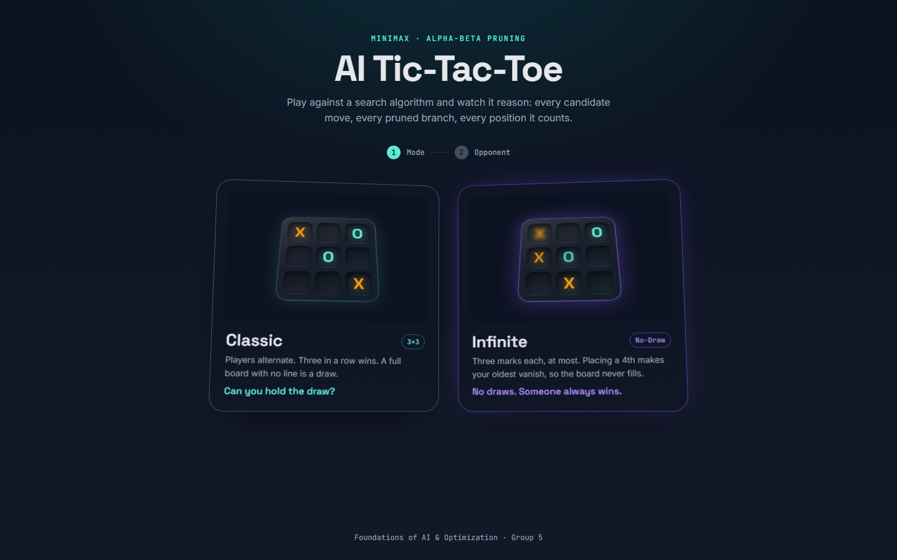

# AI Tic-Tac-Toe: Minimax with Alpha-Beta Pruning

A browser Tic-Tac-Toe game against an AI agent built on classical adversarial search. While it plays, the agent shows its reasoning: its next move, the score of every cell, the search tree with pruned branches, and how many positions Alpha-Beta saved compared with plain Minimax.

Project for **Foundations of AI and Optimization**, Group 5.



## Highlights

- **Two modes:** Classic, and *Infinite*, a no-draw variant where each player keeps only three marks.
- **Two difficulty levels:**
  - **Unbeatable:** optimal play.
  - **Normal:** a human-like opponent that looks only two moves ahead and sometimes slips.
- **AI Brain panel:** shows the chosen move and why, per-cell Minimax scores, an animated search tree with α/β values and pruned branches, and Minimax vs Alpha-Beta node counts.
- **Pure classical search:** the AI is Python 3 with the standard library only, with no machine learning and no third-party packages.
- **Verified:**
  - In Classic, the Unbeatable AI is tested against every possible human strategy.
  - The Infinite AI is checked against an independent exact solver.

## Game modes

**Classic.** Standard rules: players alternate on a 3×3 board, three in a row wins, and a full board with no line is a draw.

**Infinite (No-Draw).** Same board and same goal, but:

1. Each player can have at most 3 marks. Placing a 4th makes that player's oldest mark vanish, so the board never fills.
2. If the same position (same marks, same ages, same player to move) occurs for the 3rd time, the player who caused it loses.

Every Infinite game therefore ends with a winner. We solved the variant exactly: with perfect play **the first player can force a win in 13 moves by opening on an edge cell**. Opening on a corner or the centre does not force a win.

## Quick start

Requirements: Python 3.8 or newer (tested on 3.14). An internet connection is needed for the UI's fonts and the React runtime, which load from CDNs.

```bash
# Windows
py server.py

# macOS / Linux
python3 server.py
```

The game opens at <http://127.0.0.1:8000>. Use `--port 9000` to change the port and `--no-browser` to stop it opening a tab. The server listens on 127.0.0.1 only.

If the page is opened without the server, the UI falls back to the JavaScript engine from the design prototype and logs a warning in the browser console.

### Controls

| Action | Input |
|---|---|
| Place a mark | Click a cell, or press `1`–`9` (reading order, 1 = top-left) |
| Move the keyboard cursor | Arrow keys, then `Enter` or `Space` |
| Replay the AI's search | **Replay thinking** in the search-tree card |
| Preview every UI state | `~` opens the dev state switcher |

## How the AI works

### The game as a search problem

| Component | Implementation |
|---|---|
| State | `State(X, O, to_move)`. X and O are tuples of cells, oldest first, so mark ages are part of the state |
| Actions | `available_moves()`: the empty cells |
| Transition model | `result()`: places a mark and, in Infinite mode, removes the mover's oldest mark |
| Terminal test | a completed line, a full board (Classic), or a third repetition (Infinite) |
| Utility | `utility()`: `+(1000 − plies)` for an AI win, `−(1000 − plies)` for a loss, `0` for a draw. Faster wins and slower losses score higher |

### Search

- **Minimax** (`minimax()`): the AI is MAX and the human is MIN, and values are backed up from terminal positions. It is used as the baseline.
- **Alpha-Beta pruning** (`alphabeta()`): α is the best score MAX can guarantee and β the best MIN can guarantee. When `α ≥ β` the remaining moves cannot change the decision and are skipped. It returns exactly the same value as Minimax, and the tests check this on every reachable Classic position up to 4 moves deep.
- **Move ordering:** winning moves first, then the best move from the previous search, then centre, corners and edges. Good ordering makes pruning far more effective.
- **Depth cutoff and evaluation (Infinite):** the Infinite game tree never ends, so the search stops at a depth limit. It scores positions there with `heuristic()`, which counts open lines and immediate threats and ignores marks that are about to vanish.
- **Iterative deepening (Infinite):** the search runs at depth 1, 2, 3, … up to 14. It stops as soon as it proves a forced win or loss, or when the time budget runs out (0.8 s soft, 2.5 s hard).
- **Repetition rule:** the search counts positions along each path, on top of the game history, so it sees the third-repetition loss coming.

### Difficulty levels

| Level | Classic | Infinite |
|---|---|---|
| **Unbeatable** | Full game tree (9 plies). Never loses | Iterative deepening to 14 plies. Wins every game it starts; as second player only the perfect 13-move line beats it |
| **Normal** | Searches 2 plies; slips 30% of the time | Same |

A Normal "slip" is usually the second-best move and sometimes a random worse one. It never skips a win in one. The panel always compares the move played with the move a full-strength search recommends ("Optimal vs Played").

## Results

Plain Minimax and Alpha-Beta run on the same positions; every count below is from a real run (`py scripts/benchmark.py`).

| Position | Depth | Minimax nodes | Alpha-Beta nodes | Nodes saved | Minimax ms | Alpha-Beta ms | Same value |
|---|---:|---:|---:|---:|---:|---:|:---:|
| Classic, empty board | 9 | 549,946 | 3,391 | 99.4% | 1,141 | 19.1 | yes |
| Classic, after X takes the centre | 9 | 55,505 | 738 | 98.7% | 116 | 3.9 | yes |
| Classic, after X corner, O centre | 9 | 7,332 | 362 | 95.1% | 16 | 2.0 | yes |
| Infinite, empty board, 6 moves deep | 6 | 73,450 | 1,608 | 97.8% | 948 | 19.6 | yes |
| Infinite, empty board, 8 moves deep | 8 | 618,202 | 4,221 | 99.3% | 7,440 | 51.7 | yes |
| Infinite, mid-game, 10 moves deep | 10 | 41,137 | 356 | 99.1% | 492 | 3.2 | yes |

The Alpha-Beta figures include move ordering. Timings come from one run on a Windows 11 laptop and will vary between machines. To prove the 13-move forced win from the empty Infinite board, the full agent visits about 3,600 nodes in under a second; plain Minimax would need an estimated 200 million.

## Project structure

```
AI-TicTacToe/
├── server.py              Local web server: serves web/ and the /api endpoints
├── brain/                 The AI (Python standard library only)
│   ├── game.py            States, actions, transition model, terminal test
│   ├── evaluation.py      Utility, cutoff heuristic, UI score scale
│   ├── search.py          minimax(), alphabeta(), node counting, principal variation
│   ├── agent.py           best_move() and analyze(): difficulty levels, panel data
│   └── explain.py         Plain-English reason for each move
├── web/                   The UI (generated with Claude Design)
│   ├── index.html         Game, 3D board and AI Brain panel
│   ├── brain-client.js    Calls the Python brain
│   ├── ai-engine.js       Rule helpers, JS fallback engine, dev-state previews
│   └── support.js         Runtime for the Claude Design prototype
├── tests/
│   ├── test_brain.py      Unit and correctness tests
│   └── solver.py          Independent exact solver for Infinite mode (tests only)
├── scripts/
│   └── benchmark.py       Minimax vs Alpha-Beta comparison
└── docs/
    └── screenshots/       Image used in this README
```

## API

`POST /api/analyze`

```json
{
  "game": { "mode": "infinite", "board": { "X": [1], "O": [4] }, "toMove": "X", "history": {} },
  "opts": { "ai": "X", "difficulty": "unbeatable", "maxDepth": 14, "slipChance": 0.3 }
}
```

- `board` lists each player's cells (0–8) oldest first.
- `history` maps position keys (`"1|4|X"`) to how often each has occurred.

The response holds everything the AI Brain panel renders:

| Field | Meaning |
|---|---|
| `chosenMove`, `optimalMove` | The move played, and the best move found by a full-strength search |
| `value`, `optimalValue` | Their scores, on the UI's −10…+10 scale |
| `slip` | True if Normal played a worse move than the best one |
| `exact`, `forcedWinIn`, `forcedLossIn` | Whether the score is proven, and how many moves until a forced end |
| `candidates[]` | The score of every legal cell, and which AI mark would vanish |
| `tree` | The recorded search tree: α/β values, pruned branches, cutoffs and visit order |
| `nodes.minimax`, `nodes.alphaBeta`, `cuts` | Search statistics for the efficiency card |
| `depthLimit`, `depthReached`, `deepening[]` | Search depth and the iterative-deepening log |
| `principalVariation` | The expected line of play |
| `reason` | A plain-English reason for the move |

Open α/β bounds are sent as `"+inf"` / `"-inf"` because JSON has no Infinity. `GET /api/health` returns the engine name and version.

## Tests

```bash
py -m unittest discover -s tests -v
```

The suite checks:
- the game rules
- that Alpha-Beta always returns the same value as Minimax
- that the Minimax node counts are exact
- that the Classic AI never loses
- that the Infinite AI agrees with the exact solver and finds the 13-move win
- the repetition rule
- Normal's slips
- the shape of the response the UI reads

The whole suite runs in about 20 seconds, including Infinite mode against every human strategy. Set `QUICK=1` to skip that one test.

## Team (Group 5)

L. Mohith · M. Suchith · M. Pranay Kumar Reddy · P. Kartikeya · K. Shreenandh

## License

Released under the [MIT License](LICENSE): free to use, copy, modify and share, as long as the copyright notice is kept.

## Acknowledgements

The UI was designed with Claude Design. The algorithms follow the adversarial search chapter of Russell & Norvig, *Artificial Intelligence: A Modern Approach*.
